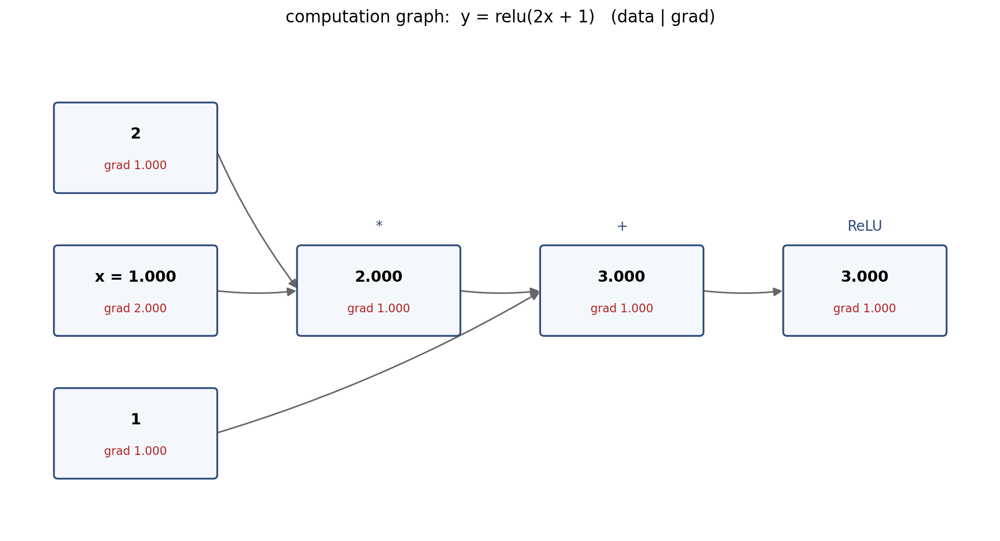
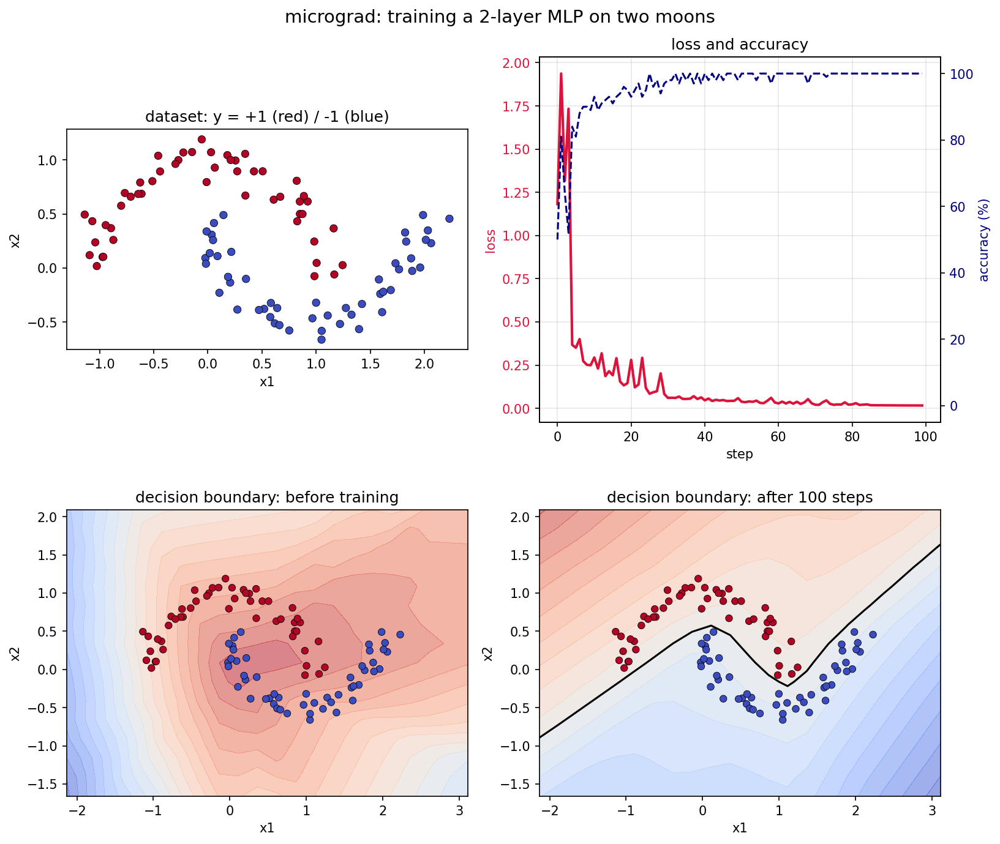

# micrograd 逐步导读：从标量到神经网络

> 目标：读完并跑完这份导读，你能从零解释这句话——
>
> **神经网络就是一个可微函数；训练就是用反向传播算出损失对每个参数的梯度，再沿梯度反方向走一小步。**

这份导读基于 Andrej Karpathy 的 [micrograd](https://github.com/karpathy/micrograd)。原项目只有两个核心代码文件：

- [micrograd/engine.py](micrograd/engine.py)：约 94 行，标量自动微分引擎；
- [micrograd/nn.py](micrograd/nn.py)：约 60 行，神经元 / 层 / MLP；
- [demo.ipynb](https://github.com/karpathy/micrograd/blob/master/demo.ipynb)：在“双月”数据集上训练一个二分类 MLP。

本仓库把原项目的两个核心文件放在 `micrograd/`，并配上了中文导读、7 个实验脚本和训练结果图。你不需要安装 micrograd，也不需要 sklearn。

它不追求性能，而是把神经网络拆到**单个标量运算**的粒度，让你看清每一个 `+`、`*`、`ReLU` 的梯度是怎么流动的。看懂它，再去看 PyTorch 就不会觉得是黑魔法了。

---

## 0. 先建立全局图景

### 0.1 神经网络在做什么

一个神经网络就是一个带参数的函数：

$$
f(x; W, b) = \text{输出分数}
$$

训练它，就是找一组参数 $W, b$，让模型在训练数据上的**损失**尽量小：

$$
\min_{W,b} \; L(f(x; W,b), y)
$$

### 0.2 训练的四件套

```text
① 前向传播 forward   ：x -> 模型 -> 分数 s -> 损失 L
② 反向传播 backward  ：从 L 出发，算出 dL/d(每个参数)
③ 梯度下降 update    ：param <- param - lr * dL/dparam
④ 重复               ：直到损失收敛
```

难点只有一个：**第 ② 步，怎么高效地算出所有参数的梯度？**

micrograd 的答案是：把前向过程记录成一张计算图，然后从输出往输入走一遍，用链式法则把梯度传回去。这就是**反向模式自动微分**（reverse-mode autodiff），也就是 PyTorch 的 `loss.backward()`。

### 0.3 为什么用“标量”而不是矩阵

真实框架里，一层是矩阵乘法：

$$
z = Wx + b
$$

micrograd 把矩阵拆成一个个标量：

$$
z_j = \sum_i w_{ji} x_i + b_j
$$

每个 $w_{ji} x_i$ 都是一个独立的节点。这样做非常慢，但**每一个局部导数都暴露在你眼前**。矩阵版本只是把几万个标量运算打包成一次高效的内核调用，链式法则本身完全一样。

### 0.4 目录地图

```text
micrograd-study/
├── README.md                  ← 你正在读的这份导读
├── LICENSE                    ← MIT 许可证
├── NOTICE                     ← 原项目版权说明
├── requirements.txt
├── .gitignore
├── .gitattributes
├── micrograd/                 ← 原项目的两个核心文件
│   ├── __init__.py
│   ├── engine.py
│   └── nn.py
├── 01_forward.py              ← 前向：表达式如何变成图
├── 02_backward_manual.py      ← 手工反向：链式法则
├── 03_autograd.py             ← 自动反向：backward() 与数值校验
├── 04_neuron.py               ← 一个神经元
├── 05_mlp.py                  ← 层与 MLP、参数量
├── 06_train.py                ← 完整训练 + 决策边界
├── 07_visualize.py            ← 用 matplotlib 画计算图
└── figs/
    ├── computation_graph.png
    └── training_result.png
```

运行方式（在仓库根目录）：

```bash
python 01_forward.py
python 02_backward_manual.py
python 03_autograd.py
python 04_neuron.py
python 05_mlp.py
python 06_train.py
python 07_visualize.py
```

脚本直接 `from micrograd.engine import Value`。因为 `micrograd/` 就在仓库根目录，从根目录运行即可，不需要安装，也不需要改 `sys.path`。

### 0.5 建议的学习节奏

| 阶段 | 做什么 | 对应文件 |
|---|---|---|
| 第 1 遍 | 跑脚本，看输出，建立直觉 | 01–05 |
| 第 2 遍 | 读 `engine.py` / `nn.py` 源码，逐行对上 | 本导读第 2–6 节 |
| 第 3 遍 | 跑完整训练，改超参数做实验 | 06 |
| 第 4 遍 | 做第 11 节练习，自己加算子/改损失 | 自己写 |

如果只有 30 分钟：先跑 `01` → `02` → `03` → `04`，再读第 1–4 节。完整训练和决策边界留到第二遍。

---

## 1. 第一步：把数字变成节点

### 1.1 `Value` 里存了什么

打开 `micrograd/engine.py`，核心是一个类：

```python
class Value:
    def __init__(self, data, _children=(), _op=''):
        self.data = data          # 前向数值
        self.grad = 0             # 反向梯度，初始为 0
        self._backward = lambda: None   # 这个节点如何把梯度传给子节点
        self._prev = set(_children)     # 计算图里的子节点
        self._op = _op                  # 产生这个节点的运算，调试用
```

四个关键字段：

| 字段 | 含义 |
|---|---|
| `data` | 这个节点的数值，前向算出来的 |
| `grad` | 损失对这个节点的偏导 $\partial L/\partial v$，反向算出来的 |
| `_prev` | 这个节点依赖哪些节点（计算图的边） |
| `_backward` | 一个函数：把 `self.grad` 分给 `_prev` 里的节点 |

`_op` 只用于调试和画图，不参与计算。

### 1.2 一次加法发生了什么

```python
def __add__(self, other):
    other = other if isinstance(other, Value) else Value(other)
    out = Value(self.data + other.data, (self, other), '+')

    def _backward():
        self.grad += out.grad
        other.grad += out.grad
    out._backward = _backward

    return out
```

逐行读：

1. `other` 可能是个普通数字（比如 `x + 1`），先把它包装成 `Value`，这样图里每个节点都是 `Value`。
2. 新建输出节点 `out`，数值是两者相加，`_children` 记录 `(self, other)`，`_op` 记录 `'+'`。
3. 定义闭包 `_backward`：加法的局部导数是 1，所以把 `out.grad` **原样**加给两个子节点。
4. 把闭包挂到 `out` 上，返回。

注意 `+=`：一个节点可能被多条路径使用，梯度要**累加**，不能覆盖。第 2 节会详细讲。

### 1.3 一次乘法

```python
def __mul__(self, other):
    other = other if isinstance(other, Value) else Value(other)
    out = Value(self.data * other.data, (self, other), '*')

    def _backward():
        self.grad += other.data * out.grad
        other.grad += self.data * out.grad
    out._backward = _backward

    return out
```

局部导数：

$$
z = x \cdot y \quad\Rightarrow\quad \frac{\partial z}{\partial x}=y,\quad \frac{\partial z}{\partial y}=x
$$

所以 `x.grad += y.data * out.grad`，`y.grad += x.data * out.grad`。

### 1.4 前向就是在建图

```python
x = Value(1.0)
y = (x * 2 + 1).relu()
```

这两行做了：

```text
x (1.0) ──┐
          ├──[*]── 2.0 ──┐
2.0 ──────┘              ├──[+]── 3.0 ──[ReLU]── 3.0
1.0 ─────────────────────┘
```

每个中间结果都是一个 `Value`，`_prev` 指向上游。`y` 是图的根，沿着 `_prev` 递归就能找到所有节点。

跑 `python 01_forward.py`，你会看到类似：

```text
y = Value(data=3.0, grad=0)
y._op = ReLU
y._prev 里有 1 个直接子节点

从输出 y 往上走，能看到的整张图（拓扑序：先叶子，后输出）：
   0.  leaf | data=  1.000 | grad= 0.00
   1.  leaf | data=  2.000 | grad= 0.00
   2.     * | data=  2.000 | grad= 0.00
   3.  leaf | data=  1.000 | grad= 0.00
   4.     + | data=  3.000 | grad= 0.00
   5.  ReLU | data=  3.000 | grad= 0.00
```

此时所有 `grad` 都是 0，因为还没反向传播。

### 1.5 为什么要有运算符重载

`engine.py` 后半段是一堆“语法糖”：

```python
def __neg__(self):      return self * -1
def __radd__(self, other): return self + other
def __sub__(self, other):  return self + (-other)
def __rsub__(self, other): return other + (-self)
def __rmul__(self, other): return self * other
def __truediv__(self, other):  return self * other**-1
def __rtruediv__(self, other): return other * self**-1
```

它们让 `a - b`、`1 + a`、`2 * a`、`a / b` 这些写法都能直接建图。对照表：

| 你写的 | Python 实际调用 | 最终等价于 |
|---|---|---|
| `a + b` | `a.__add__(b)` | 加法节点 |
| `1 + a` | `a.__radd__(1)` | `a + 1` |
| `a - b` | `a.__sub__(b)` | `a + (-b)` |
| `1 - a` | `a.__rsub__(1)` | `1 + (-a)` |
| `a * b` | `a.__mul__(b)` | 乘法节点 |
| `2 * a` | `a.__rmul__(2)` | `a * 2` |
| `a / b` | `a.__truediv__(b)` | `a * b**-1` |
| `2 / a` | `a.__rtruediv__(2)` | `2 * a**-1` |
| `a ** 2` | `a.__pow__(2)` | 幂节点 |

`demo.ipynb` 里那些看起来像普通数学的表达式，正是靠这些方法建图的。

### 1.6 一个容易忽略的细节：`_prev` 是 `set`

`x * x` 的 `_children` 是 `(x, x)`，但 `set(_children)` 只会留下一个 `x`。图里只有一条边，可是 `_backward` 里两行代码都会执行，所以 `x.grad` 仍然加了两次：

```python
self.grad += other.data * out.grad   # 左乘数
other.grad += self.data * out.grad   # 右乘数（self 和 other 是同一个 x）
```

**节点去重，但局部梯度不丢**。这是 `set` 能安全使用的原因。

---

## 2. 第二步：梯度、链式法则与“为什么要累加”

### 2.1 梯度是什么

对单变量函数 $y=f(x)$，导数 $\frac{dy}{dx}$ 表示 $x$ 增加一点点时 $y$ 的变化率。

对多变量函数 $L=f(x_1,\dots,x_n)$，梯度是一组偏导：

$$
\nabla L = \left(\frac{\partial L}{\partial x_1},\dots,\frac{\partial L}{\partial x_n}\right)
$$

梯度方向是函数**上升最快**的方向，所以最小化时往反方向走：

$$
x_i \leftarrow x_i - \eta \frac{\partial L}{\partial x_i}
$$

$\eta$ 是学习率。

### 2.2 链式法则

如果 $L$ 依赖 $z$，$z$ 依赖 $x$：

$$
\frac{\partial L}{\partial x} = \frac{\partial L}{\partial z}\cdot\frac{\partial z}{\partial x}
$$

如果 $x$ 通过多条路径影响 $L$：

$$
\frac{\partial L}{\partial x} = \sum_{\text{所有路径}} \left(\text{路径上局部导数的乘积}\right)
$$

这就是为什么反向传播里到处都是 `+=`。

### 2.3 四个基本门的局部导数

| 前向 | 局部导数 | 反向代码 |
|---|---|---|
| $z=x+y$ | $\partial z/\partial x=1$ | `x.grad += z.grad` |
| $z=x\cdot y$ | $\partial z/\partial x=y$ | `x.grad += y.data * z.grad` |
| $z=\max(0,x)$ | $1$ if $x>0$ else $0$ | `x.grad += (z.data > 0) * z.grad` |
| $z=x^k$ | $kx^{k-1}$ | `x.grad += k*x.data**(k-1) * z.grad` |

有了这四条，再加上“多条路径求和”，就能对任意由这些运算组成的表达式求导。

### 2.4 手工推导一个例子

```text
m = x * 2
a = m + 1
y = relu(a)
```

在 $x=1$ 时：$m=2,\ a=3,\ y=3$。

反向：

```text
y.grad = 1
a.grad = 1          # ReLU 在 a>0 时直通
m.grad = 1          # 加法原样分发
one.grad = 1
x.grad = 2 * 1 = 2  # 乘法：乘以另一个乘数 2
two.grad = 1 * 1 = 1
```

用中心差分验证：

$$
\frac{dy}{dx}\approx\frac{f(1+10^{-6})-f(1-10^{-6})}{2\times10^{-6}}\approx 2
$$

跑 `python 02_backward_manual.py` 可以看到完整过程，包括：

- ReLU 关闭时（$a<0$）梯度被截断为 0；
- 菱形结构 `y = x*x + x` 在 $x=3$ 处的梯度是 $2x+1=7$，两条 $x*x$ 路径必须累加。

### 2.5 如果忘记 `+=` 会怎样

对 `y = x*x + x`，$x=3$：

- 正确：`x.grad = 3 + 3 + 1 = 7`
- 如果两条乘法路径用 `=` 覆盖：最后只会保留其中一条路径的 3，或者再加 1 得到 4，取决于覆盖顺序；总之漏掉了一条路径，不是 7。

反向传播的本质是“把上游梯度分发给所有下游路径”，所以**累加是语义的一部分，不是实现细节**。

### 2.6 为什么从 `grad = 1` 开始

如果 $L$ 是最终标量损失，那么：

$$
\frac{\partial L}{\partial L}=1
$$

把输出节点的 `grad` 设为 1，相当于“损失对自己求导等于 1”，然后链式法则一路把梯度传回去。

如果输出不是标量（比如一个向量），就需要给每个输出分量一个“种子梯度”，这就是 Jacobian-vector product 的起点。micrograd 只处理标量，所以直接设为 1。

---

## 3. 第三步：自动反向传播

### 3.1 每个节点记住自己的“反向操作”

在 `__add__` / `__mul__` / `relu` 里，前向时顺手定义了一个闭包：

```python
def _backward():
    self.grad += other.data * out.grad
    other.grad += self.data * out.grad
out._backward = _backward
```

这个闭包捕获了 `self`、`other`、`out`。等反向传播走到 `out` 时，`out.grad` 已经通过所有下游路径累加好了，调用 `out._backward()` 就能把梯度分给它的子节点。

叶子节点的 `_backward` 是 `lambda: None`，什么也不做。

### 3.2 `backward()` 的三步

```python
def backward(self):
    # 1) 拓扑排序：先子节点，后父节点
    topo = []
    visited = set()
    def build_topo(v):
        if v not in visited:
            visited.add(v)
            for child in v._prev:
                build_topo(child)
            topo.append(v)
    build_topo(self)

    # 2) 输出节点的种子梯度
    self.grad = 1

    # 3) 逆序执行每个节点的 _backward
    for v in reversed(topo):
        v._backward()
```

#### 为什么需要拓扑排序

计算图是有向无环图（DAG），边从输入指向输出。反向传播要求：**处理一个节点时，所有消费它的节点都已经把梯度贡献完了**。

拓扑排序（DFS 后序）保证：子节点一定排在父节点前面。反转后，父节点先执行，子节点后执行。这样每个节点被调用 `_backward()` 时，它的 `grad` 已经是最终值。

如果顺序错了，某个节点可能只收到一部分梯度，就被处理并继续往下传，结果偏小。

#### 为什么是 O(节点数 + 边数)

每个节点入栈一次、出栈一次，每条边遍历一次。一次前向 + 一次反向，复杂度与图的大小成线性关系。这就是反向传播比“对每个参数单独做数值差分”高效的原因：数值差分需要 $O(\text{参数个数})$ 次前向，反向传播只需要一次前向 + 一次反向。

### 3.3 跑一遍自动微分

`python 03_autograd.py` 复现 README 里的复杂表达式：

```python
a = Value(-4.0)
b = Value(2.0)
c = a + b
d = a * b + b**3
c += c + 1
c += 1 + c + (-a)
d += d * 2 + (b + a).relu()
d += 3 * d + (b - a).relu()
e = c - d
f = e**2
g = f / 2.0
g += 10.0 / f
```

输出：

```text
前向：g = 24.7041
反向：dg/da = 138.8338
      dg/db = 645.5773

数值梯度校验（中心差分）：
  dg/da ≈ 138.8338
  dg/db ≈ 645.5773
```

数值梯度和 autograd 一致，说明实现正确。

> 小细节：`c += c + 1` 不是原地修改，而是 `c = c + (c + 1)`，创建了一个新节点；旧 `c` 仍然是图的一部分。`d += ...` 同理。这正是计算图能保留完整历史的原因。

### 3.4 连续调用 `backward()` 会累加

```python
x = Value(2.0)
y = x * x
y.backward()   # x.grad = 4
y.backward()   # x.grad = 8
```

`backward()` 只把根节点的 `grad` 重置为 1，不会清空参数的 `grad`。所以训练循环里每步都要：

```python
model.zero_grad()
```

否则梯度会跨步累加，更新量越来越大，训练容易发散。

### 3.5 计算图长什么样

`python 07_visualize.py` 会生成：



每个方框里，上排是前向数值，下排是反向梯度。你可以清楚地看到：

- `x` 的梯度是 2（乘法把梯度乘以另一个乘数 2）；
- 常量 2 的梯度是 1（乘以 x=1）；
- 加法和 ReLU 都直通，梯度保持 1。

原版教程用 graphviz 的 `draw_dot` 画同样的图；这里用 matplotlib 重写，避免安装 graphviz。

---

## 4. 第四步：从标量到神经元

### 4.1 一个神经元是什么

一个神经元做两件事：

$$
z = \sum_{i=1}^{n} w_i x_i + b
$$

$$
a = \text{ReLU}(z) = \max(0, z)
$$

- $w_i$：权重，每个输入一个；
- $b$：偏置；
- $z$：线性组合（logit / 预激活）；
- $a$：激活后的输出。

参数个数：$n+1$。

### 4.2 源码

`micrograd/nn.py`：

```python
class Neuron(Module):
    def __init__(self, nin, nonlin=True):
        self.w = [Value(random.uniform(-1,1)) for _ in range(nin)]
        self.b = Value(0)
        self.nonlin = nonlin

    def __call__(self, x):
        act = sum((wi*xi for wi,xi in zip(self.w, x)), self.b)
        return act.relu() if self.nonlin else act

    def parameters(self):
        return self.w + [self.b]
```

几个要点：

1. **权重初始化**：`random.uniform(-1,1)`，小随机数。不能全初始化为 0，否则同一层的神经元梯度相同，永远学成一样的（对称性问题）。
2. **偏置初始化为 0**：可以，偏置不会被对称性卡住。
3. **`sum(..., self.b)`**：Python 的 `sum` 第二个参数是起点。这里从 `self.b` 开始，等价于 $b + \sum w_i x_i$。如果写 `sum(...)`，起点是 0，会走 `Value.__radd__`，但偏置就漏掉了。
4. **`zip(self.w, x)`**：按位置配对；假设输入维度等于 `nin`。
5. **`nonlin`**：控制是否加 ReLU。最后一层会关掉。

### 4.3 手算一个神经元

把参数设成 $w=[1.5,-0.5]$，$b=0.25$，输入 $x=[1,-2]$：

$$
z = 1.5\times1 + (-0.5)\times(-2) + 0.25 = 2.75
$$

$$
a = \text{ReLU}(2.75) = 2.75
$$

反向，因为 $z>0$：

$$
\frac{\partial a}{\partial w_1}=x_1=1,\quad
\frac{\partial a}{\partial w_2}=x_2=-2,\quad
\frac{\partial a}{\partial b}=1
$$

跑 `python 04_neuron.py` 可以验证。

### 4.4 ReLU 的“闸门”

如果 $z<0$，ReLU 输出 0，局部导数为 0，所有上游梯度都被截断：

```text
z = -3, a = 0
da/dw = 0, da/db = 0
```

这个神经元当前对损失没有贡献，参数不会更新。如果学习率太大，神经元可能长期落在负数区，永远不激活，这就是 **dead ReLU**。实际训练中会用较小的学习率、合适的初始化，或者换 LeakyReLU/GELU 等激活函数。

### 4.5 为什么必须有非线性

如果所有层都是线性的：

$$
f(x) = W_2(W_1 x + b_1) + b_2 = (W_2W_1)x + (W_2b_1+b_2)
$$

多层线性叠加仍然是一个线性函数，深度完全浪费。ReLU 引入了折点，让网络能逼近弯曲的决策边界。这就是“深度”有意义的前提。

> 严格地说，单层线性模型只能画直线；带 ReLU 的隐藏层可以把空间折来折去，最后用一个线性分类器切开。第 8 节的决策边界会直观展示这一点。

---

## 5. 第五步：层与 MLP

### 5.1 层：并行的神经元

```python
class Layer(Module):
    def __init__(self, nin, nout, **kwargs):
        self.neurons = [Neuron(nin, **kwargs) for _ in range(nout)]

    def __call__(self, x):
        out = [n(x) for n in self.neurons]
        return out[0] if len(out) == 1 else out

    def parameters(self):
        return [p for n in self.neurons for p in n.parameters()]
```

- 一层有 `nout` 个神经元，每个都看同样的 `nin` 维输入；
- 每个神经元有独立的 `w` 和 `b`；
- 输出是一个长度为 `nout` 的列表（除非只有 1 个神经元，直接返回标量，方便最后一层）。

> 实现约定：`nout == 1` 时返回标量而不是 `[标量]`。这方便了最后一层，但也意味着 **MLP 的隐藏层宽度不能设为 1**，否则下一层拿到的是 `Value` 而不是列表，`for n in self.neurons` 里的 `zip` 会报错。这是极简实现的取舍，真实框架不会这样。

### 5.2 MLP：串行的层

```python
class MLP(Module):
    def __init__(self, nin, nouts):
        sz = [nin] + nouts
        self.layers = [
            Layer(sz[i], sz[i+1], nonlin=i != len(nouts)-1)
            for i in range(len(nouts))
        ]

    def __call__(self, x):
        for layer in self.layers:
            x = layer(x)
        return x

    def parameters(self):
        return [p for layer in self.layers for p in layer.parameters()]
```

`MLP(2, [16, 16, 1])`：

```text
sz = [2, 16, 16, 1]
Layer(2, 16)    ReLU
Layer(16, 16)   ReLU
Layer(16, 1)    Linear
```

3 层，2 个隐藏层，1 个输出层。

### 5.3 参数量

每个 `Layer(nin, nout)` 有 `nout` 个神经元，每个 `nin+1` 个参数：

$$
\text{params} = n_{\text{out}} \times (n_{\text{in}} + 1)
$$

所以：

| 层 | 计算 | 参数 |
|---|---|---|
| Layer(2,16) | 16 × (2+1) | 48 |
| Layer(16,16) | 16 × (16+1) | 272 |
| Layer(16,1) | 1 × (16+1) | 17 |
| 合计 | | **337** |

跑 `python 05_mlp.py` 可以验证。

### 5.4 为什么最后一层不加 ReLU

损失函数直接使用输出分数 $s$：

- $y=+1$ 时，希望 $s\ge 1$；
- $y=-1$ 时，希望 $s\le -1$。

如果最后一层加 ReLU，$s\ge 0$，那么 $y=-1$ 的样本永远无法得到 $s\le -1$ 的“正确且有余量”的分数，损失无法降到 0。所以最后一层保持线性，输出原始 logit。

隐藏层加 ReLU 是为了非线性；输出层不加是为了保留正负号。

### 5.5 参数展平

`parameters()` 递归地把所有层的所有神经元的 `w` 和 `b` 收集成一个列表。训练时只需要：

```python
for p in model.parameters():
    p.data -= lr * p.grad
```

这就是为什么 `Module` 要定义 `parameters()` 和 `zero_grad()`：给优化器一个统一的接口。

---

## 6. 第六步：损失函数

### 6.1 从分数到损失

模型对每个样本输出一个分数 $s_i$。标签 $y_i\in\{-1,+1\}$。

我们希望：

- $y_i=+1$：$s_i$ 至少是 $+1$；
- $y_i=-1$：$s_i$ 至少是 $-1$。

定义间隔（margin）：

$$
m_i = y_i s_i
$$

$m_i$ 越大，分类越自信且正确。SVM 的 **max-margin hinge loss**：

$$
\ell_i = \max(0, 1 - y_i s_i)
$$

- 如果 $y_i s_i \ge 1$：损失为 0，已经分类正确且有余量；
- 如果 $y_i s_i < 1$：损失为正，模型被惩罚。

总数据损失：

$$
L_{\text{data}} = \frac{1}{N}\sum_{i=1}^N \ell_i
$$

### 6.2 为什么是 `1 + -yi*scorei`

代码：

```python
losses = [(1 + -yi*scorei).relu() for yi, scorei in zip(yb, scores)]
data_loss = sum(losses) * (1.0 / len(losses))
```

`1 + -yi*scorei` 就是 $1 - y_i s_i$；`.relu()` 就是 $\max(0,\cdot)$。

对分数的梯度：

$$
\frac{\partial \ell_i}{\partial s_i} =
\begin{cases}
-y_i, & 1-y_i s_i > 0\\
0, & \text{否则}
\end{cases}
$$

直观理解：

- $y_i=+1$，分数不够大（$s_i<1$）：梯度为 $-1$，把 $s_i$ 往上推；
- $y_i=-1$，分数不够小（$s_i>-1$）：梯度为 $+1$，把 $s_i$ 往下推；
- 已经满足间隔：梯度为 0，不再调整。

### 6.3 L2 正则

```python
alpha = 1e-4
reg_loss = alpha * sum((p*p for p in model.parameters()))
total_loss = data_loss + reg_loss
```

$$
L_{\text{reg}} = \alpha \sum_j p_j^2
$$

作用：惩罚过大的参数，让模型更平滑，减少过拟合。$\alpha$ 是超参数：太大欠拟合，太小正则无效。

总损失：

$$
L = L_{\text{data}} + L_{\text{reg}}
$$

### 6.4 准确率

```python
accuracy = [(yi > 0) == (scorei.data > 0) for yi, scorei in zip(yb, scores)]
```

只取 `.data` 做符号判断，不参与求导。`score > 0` 预测 $+1$，否则 $-1$。

注意：准确率是**不可微**的，不能直接拿来做损失；它只用于监控。

### 6.5 这个损失和 softmax 交叉熵的区别

- Hinge loss 只关心“有没有超过间隔”，不输出概率；
- Softmax + 交叉熵输出概率分布，梯度形式不同，但思想一样：正确类分数不够高就惩罚；
- 二分类里，logistic + BCE 也很常见。

micrograd 选 hinge loss 是因为它简单，且只需要 `relu`，不需要 `exp/log`。

---

## 7. 第七步：训练循环

### 7.1 五步循环

`demo.ipynb` 的核心：

```python
for k in range(100):
    total_loss, acc = loss()

    model.zero_grad()
    total_loss.backward()

    learning_rate = 1.0 - 0.9*k/100
    for p in model.parameters():
        p.data -= learning_rate * p.grad
```

对应：

```text
① forward   : loss() 内部完成 X -> scores -> loss
② zero_grad : 清空上一步的梯度
③ backward  : 反向传播，填充每个 p.grad
④ update    : p.data -= lr * p.grad
⑤ log       : 打印 loss / accuracy
```

### 7.2 为什么必须 `zero_grad`

第 3.4 节看到，`backward()` 是累加的。如果不清零：

```text
step 1: grad = g1
step 2: grad = g1 + g2
step 3: grad = g1 + g2 + g3
```

更新量会越来越大，等效学习率不断上升，训练很快发散。`zero_grad()` 把所有参数的 `grad` 置 0：

```python
def zero_grad(self):
    for p in self.parameters():
        p.grad = 0
```

### 7.3 为什么是 `p.data -=` 而不是 `p -=`

```python
p.data -= lr * p.grad   # 正确
```

- `p` 是 `Value` 对象，模型内部持有它的引用；
- 我们只想改它的数值 `data`，不想为“更新”再建计算图；
- `p.data` 是普通 float，原地减法。

如果写：

```python
p = p - lr * p.grad   # 错误
```

`p` 只是循环变量，重新绑定到新的 `Value`，模型里的那个参数对象根本没变；而且会新建一堆计算图节点，浪费内存。

### 7.4 学习率衰减

```python
learning_rate = 1.0 - 0.9*k/100
```

从 1.0 线性降到 0.1：

- 前期大步走，快速靠近最优点；
- 后期小步走，减少震荡，精细收敛。

学习率是最重要的超参数之一。太大：loss 震荡/发散；太小：收敛慢。

### 7.5 完整训练

`python 06_train.py` 在 100 个双月样本上训练 `MLP(2,[16,16,1])`。输出类似：

```text
数据：X.shape = (100, 2), y.shape = (100,)
模型：MLP of [...]
参数个数：337

开始训练：
step      loss      acc     lr
   0    1.1820    50.0%   1.00
  10    0.2943    93.0%   0.91
  20    0.2808    93.0%   0.82
  30    0.0605    98.0%   0.73
  40    0.0465   100.0%   0.64
  50    0.0381   100.0%   0.55
  60    0.0286   100.0%   0.46
  70    0.0208   100.0%   0.37
  80    0.0231   100.0%   0.28
  90    0.0176   100.0%   0.19
  99    0.0166   100.0%   0.11

训练结束：loss = 0.0165, accuracy = 100.0%
```

你的输出可能在小数末位略有差异（浮点加法顺序、Python 版本），但趋势一致。

在普通笔记本上大约 30–40 秒。如果太慢，可以把 `n_steps` 改成 50，或把隐藏层改成 `[8,8,1]`。

### 7.6 训练日志怎么看

- **loss 总体下降**：模型在学习；
- **accuracy 上升**：分类边界在变好；
- **loss 有毛刺/尖峰**：学习率偏大，或样本少、梯度的随机性；
- **loss 不降**：学习率太小、初始化不好、数据/标签有问题；
- **loss 降但准确率不升**：可能过拟合，或阈值/类别不平衡。

本例第 0 步就 50% 是因为初始分数接近 0，符号随机；第 10 步已经 93%。

---

## 8. 第八步：决策边界与泛化

### 8.1 画决策边界

在二维平面上铺网格，每个点送入模型，按分数的正负分区，并画出 `score = 0` 的等高线：

```python
xx, yy = np.meshgrid(np.arange(x_min, x_max, h),
                     np.arange(y_min, y_max, h))
Xmesh = np.c_[xx.ravel(), yy.ravel()]
inputs = [list(map(Value, xrow)) for xrow in Xmesh]
scores = list(map(model, inputs))
Z = np.array([s.data for s in scores]).reshape(xx.shape)

plt.contourf(xx, yy, Z, levels=24, cmap="coolwarm", alpha=0.55)
plt.contour(xx, yy, Z, levels=[0], colors="k")
```

`score = 0` 的等高线就是决策边界。`h` 是网格分辨率：越小越平滑，但计算越慢；图上的边界有轻微锯齿是网格离散化造成的，不代表模型本身是折线。

`python 06_train.py` 生成：



四张图：

1. 数据分布：两个交错的半月；
2. loss / accuracy 曲线；
3. 训练前的边界：随机参数，分界线比较平滑、几乎不弯；
4. 训练后的边界：弯曲，把两个交错的半月分开。

### 8.2 决策边界说明了什么

- 线性模型只能画一条直线，无法分开交错的半月；
- 带 ReLU 隐藏层的 MLP 可以把空间“折叠”，画出弯曲边界；
- 隐藏层越宽/越深，边界可以越复杂，但也越容易过拟合。

### 8.3 训练准确率 ≠ 泛化能力

本例报告的是**训练集**准确率 100%。如果换一批同分布的新样本，准确率可能低一些。

严谨的做法：

1. 生成 200 个样本；
2. 前 100 个训练，后 100 个测试；
3. 只在前 100 个上更新参数；
4. 在测试集上评估。

这就是训练集/测试集划分。练习 6 会让你做这件事。

### 8.4 过拟合与欠拟合

| 现象 | 训练 loss | 训练 acc | 测试 acc | 原因 |
|---|---|---|---|---|
| 欠拟合 | 高 | 低 | 低 | 模型太简单/训练不够 |
| 合适 | 低 | 高 | 高 | 学到了规律 |
| 过拟合 | 很低 | 很高 | 低 | 记住了训练集噪声 |

对策：更多数据、正则化、早停、减小模型、数据增强等。

---

## 9. 把 micrograd 映射到 PyTorch

### 9.1 对照表

| micrograd | PyTorch |
|---|---|
| `Value(data)` | `torch.tensor(data, requires_grad=True)` |
| `v.data` | `v.item()`（取标量值）/ `v.detach()`（脱离计算图） |
| `v.grad` | `v.grad` |
| `v.backward()` | `loss.backward()` |
| `_prev` / `_backward` | autograd 引擎内部图 |
| `Neuron` | `nn.Linear(nin, 1)` + 激活 |
| `Layer` | `nn.Linear(nin, nout)` + 激活 |
| `MLP` | `nn.Sequential(...)` |
| `model.parameters()` | `model.parameters()` |
| `model.zero_grad()` | `optimizer.zero_grad()` |
| `p.data -= lr*p.grad` | `optimizer.step()` |
| hinge loss | `torch.clamp(1 - y*s, min=0).mean()` |

### 9.2 PyTorch 版本（可选，需安装 torch）

```python
import torch
import torch.nn as nn

# 假设已经由 numpy 转过：
# X_torch = torch.tensor(X, dtype=torch.float32)
# y_torch = torch.tensor(y, dtype=torch.float32)

model = nn.Sequential(
    nn.Linear(2, 16), nn.ReLU(),
    nn.Linear(16, 16), nn.ReLU(),
    nn.Linear(16, 1),
)
opt = torch.optim.SGD(model.parameters(), lr=0.1)

for step in range(100):
    s = model(X_torch).squeeze(1)          # (N,)
    loss = torch.clamp(1 - y_torch * s, min=0).mean()
    loss = loss + 1e-4 * sum(p.pow(2).sum() for p in model.parameters())

    opt.zero_grad()
    loss.backward()
    opt.step()
```

区别：

- PyTorch 一次处理一个 batch 的张量，micrograd 一次一个标量样本；
- PyTorch 的 `nn.Linear` 自动处理权重形状、初始化和偏置；
- `optimizer.step()` 封装了 `p.data -= lr*p.grad`；
- 反向传播的数学完全一样。

### 9.3 真实框架多了什么

- **张量 + 广播**：一次算整个 batch，GPU 并行；
- **高效内核**：矩阵乘法、卷积、LayerNorm 等；
- **数值稳定**：log-sum-exp、混合精度；
- **优化器**：Momentum、Adam、AdamW；
- **初始化/正则/调度**：He 初始化、Dropout、weight decay、warmup；
- **工程生态**：数据加载、分布式、编译、部署。

但 core idea 仍然是：前向建图 → 损失 → 反向链式法则 → 更新。

---

## 10. micrograd 的局限

1. **标量粒度**：337 个参数、100 个样本，100 步要 30 多秒；真实模型有数十亿参数。
2. **没有广播**：输入必须是 `list[Value]`，不能直接传 numpy 数组。
3. **没有 GPU**：纯 Python 循环。
4. **`__pow__` 只支持 int/float 指数**：不支持张量指数。
5. **没有数值稳定技巧**：比如 softmax 的 max-shift、log-sum-exp。
6. **`_prev` 是 `set`**：遍历顺序不固定，浮点加法顺序可能让末位数字略有差异（不影响正确性）。
7. **递归拓扑排序**：极深的图可能触发 Python 递归上限；真实框架用迭代/显式栈。
8. **不是生产库**：教学用途。

这些局限不影响它作为“神经网络最小完整示例”的价值。

---

## 11. 练习（从易到难）

### 练习 1：手推梯度

对 $y=\text{ReLU}(2x+1)$：

- $x=1$ 时，$dy/dx=?$
- $x=-1$ 时，$dy/dx=?$
- $x=-0.5$ 时，$2x+1=0$，导数在折点上不定义；micrograd 的 `relu` 在 0 处取哪个值？看代码 `(out.data > 0)`，想想为什么。

### 练习 2：给 `Value` 加 `tanh`

在 `engine.py` 里加：

```python
import math

def tanh(self):
    t = math.tanh(self.data)
    out = Value(t, (self,), 'tanh')
    def _backward():
        self.grad += (1 - t*t) * out.grad
    out._backward = _backward
    return out
```

然后用数值梯度验证：

```python
x = Value(0.3)
y = x.tanh()
y.backward()
print(x.grad)          # 应为 1 - tanh(0.3)^2
# 再和 (tanh(0.3+eps) - tanh(0.3-eps)) / (2*eps) 比较
```

### 练习 3：加 `exp` 和 `log`

```python
def exp(self):
    out = Value(math.exp(self.data), (self,), 'exp')
    def _backward():
        self.grad += out.data * out.grad
    out._backward = _backward
    return out

def log(self):
    out = Value(math.log(self.data), (self,), 'log')
    def _backward():
        self.grad += (1.0 / self.data) * out.grad
    out._backward = _backward
    return out
```

有了 `exp/log`，就可以实现 logistic 回归的 BCE 损失，或者 softmax 交叉熵。注意 `log` 只在 $x>0$ 时有定义；实际实现要防止 `log(0)`，通常会加一个很小的 $\epsilon$。

### 练习 4：把损失换成 MSE

对二分类，可以用：

$$
L = \frac{1}{N}\sum (s_i - y_i)^2
$$

把 `loss()` 里的 hinge 替换掉，观察决策边界和收敛速度。思考：MSE 对“分类间隔”的惩罚和 hinge 有什么不同？

### 练习 5：mini-batch

`loss(batch_size=16)` 已经写好了采样逻辑。训练时改成：

```python
total_loss, acc = loss(batch_size=16)
```

观察 loss 曲线是否更抖；为什么小批量能加速、还能带来正则化效果？

### 练习 6：训练/测试划分

生成 200 个样本：

```python
X, y = make_moons(n_samples=200, noise=0.1, seed=42)
X_train, y_train = X[:100], y[:100]
X_test, y_test = X[100:], y[100:]
```

只在前 100 个上训练，在测试集上算准确率。试试把隐藏层从 `[16,16,1]` 改成 `[64,64,1]`，看训练/测试差距。

### 练习 7：学习率实验

固定其他条件，分别用 `lr = 0.01, 0.1, 1.0`，记录 loss 曲线。画在同一张图上，观察：

- 太小：下降慢；
- 太大：震荡/发散；
- 合适：平稳下降。

### 练习 8：改网络结构

试这些结构，记录参数量和决策边界：

- `MLP(2, [1])`（纯线性，无隐藏层）
- `MLP(2, [8, 8, 1])`
- `MLP(2, [32, 32, 1])`
- `MLP(2, [16, 16, 16, 1])`

注意：不要写 `MLP(2, [1, 1])`。隐藏层只有 1 个神经元时，`Layer.__call__` 会返回标量而不是列表，下一层无法迭代。这是这个极简实现的约定，不是通用行为。

思考：参数越多，边界一定越好吗？

### 练习 9：自己实现 `draw_dot`

安装 graphviz 后，把原版 `trace_graph.ipynb` 的 `draw_dot` 跑通；或者扩展 `07_visualize.py`，让它能画一个 2 输入神经元的图（节点会更多，注意布局）。

### 练习 10：用 PyTorch 重写

安装 PyTorch 后，用第 9.2 节的代码重写，逐行对照 micrograd：

- 哪些行是等价的？
- `optimizer.step()` 替代了哪几行？
- `loss.backward()` 替代了哪几行？

---

## 12. 常见问题

### Q1：为什么要用 `set(_children)`，列表不行吗？

可以，但 `set` 自动去重，避免同一个节点被重复加入 `_prev`。去重后图仍然正确，因为局部 `_backward` 已经把重复操作数的影响算进去了（见 1.6）。

### Q2：`_backward` 闭包会不会很占内存？

会。每个中间节点都保存一个闭包，闭包又引用输入/输出节点。真实框架通常在前向时保存局部梯度的张量，反向时用统一的内核计算，减少 Python 对象开销。

### Q3：为什么 `backward()` 里是 `self.grad = 1`，不是 `+= 1`？

因为每次反向传播都从“损失对自身的导数 = 1”重新开始。参数梯度是累加的，但根节点的种子每次重置。这样连续调用 `backward()` 时，参数梯度会在旧值上继续累加（所以需要 `zero_grad`）。

### Q4：`Layer.__call__` 为什么对单输出返回标量？

为了让最后一层 `Layer(16,1)` 直接返回一个 `Value`，方便 `loss()` 里 `zip(yb, scores)` 和 `(1 + -yi*scorei)`。如果返回列表，就要写 `scorei[0]`。

### Q5：为什么 `Neuron` 的偏置初始化为 0，权重却随机？

偏置为 0 不会破坏对称性；权重如果全 0，同一层的神经元输出和梯度都一样，无法分化。随机初始化打破对称性。

### Q6：训练准确率 100% 是不是就成功了？

不是。可能过拟合。要看测试集、看决策边界是否合理、看损失是否还有余量。数据少的时候，100% 训练准确率很常见。

### Q7：为什么 `loss` 里用 `sum(losses) * (1.0/len(losses))` 而不是 `sum(losses)/len(losses)`？

两者等价。写成乘法是为了明确“平均”，也避免某些类型问题；在 micrograd 里 `Value / int` 也能工作。

### Q8：`alpha=1e-4` 怎么选？

这是超参数。可以从 `1e-2, 1e-3, 1e-4, 1e-5` 试。太大模型欠拟合，太小正则无效。用小验证集选。

---

## 13. 一页纸总结

```text
1. Value = data + grad + _prev + _backward
2. 前向：每个运算创建一个节点，记录子节点和局部反向函数
3. 反向：
   - 拓扑排序（子 -> 父）
   - 根节点 grad = 1
   - 逆序调用 _backward，梯度用 += 累加
4. 神经元：z = w·x + b，a = relu(z)
5. 层：多个神经元并行；MLP：多个层串行
6. 损失：hinge = mean(max(0, 1 - y*s)) + alpha*sum(p^2)
7. 训练：forward -> zero_grad -> backward -> p.data -= lr*p.grad
8. 评估：sign(score)，画决策边界，分训练/测试
9. PyTorch：同样的链式法则，换成张量 + 自动微分 + 优化器
```

如果只能记住一句话：

> **反向传播不是魔法，它只是把链式法则按拓扑逆序执行了一遍；`+=` 是因为一个变量可能通过多条路径影响损失。**

---

## 附录 A：运行环境

本导读在以下环境验证：

- Python 3.14
- numpy 2.4
- matplotlib 3.10
- 不需要 sklearn、graphviz、PyTorch（第 9.2 节可选）

如果缺少 numpy/matplotlib，在仓库根目录运行：

```bash
pip install -r requirements.txt
```

## 附录 B：排错

### `ModuleNotFoundError: No module named 'micrograd'`

确认你在仓库根目录运行脚本（`README.md` 和 `micrograd/` 在同一层），并且 `micrograd/` 里有 `__init__.py`、`engine.py`、`nn.py`。不要 `cd` 到 `figs/` 里面再运行。

### 跑 `pytest` 时报 `No module named 'torch'`

原版 `test/test_engine.py` 用 PyTorch 作为参考实现来对比梯度；没装 torch 时跑不了。可以先跳过，用 `03_autograd.py` 里的中心差分校验代替——它不依赖 PyTorch，验证的是同一件事。

### 画图中文乱码

本导读的图使用英文标签，避免字体问题。如果你要加中文，设置：

```python
plt.rcParams['font.sans-serif'] = ['Microsoft YaHei', 'SimHei']
plt.rcParams['axes.unicode_minus'] = False
```

### 训练很慢

micrograd 是纯 Python 标量循环。把 `n_steps` 从 100 降到 30，或把隐藏层从 `[16,16,1]` 降到 `[8,8,1]`。

### loss 变成 nan

通常是学习率太大或出现了 `log(0)`/除零。先降低学习率，检查输入范围。

---

## 附录 C：关键源码位置

| 内容 | 文件 | 行号 |
|---|---|---|
| `Value` 定义 | `micrograd/engine.py` | 2–11 |
| 加法 | `micrograd/engine.py` | 13–22 |
| 乘法 | `micrograd/engine.py` | 24–33 |
| 幂 | `micrograd/engine.py` | 35–43 |
| ReLU | `micrograd/engine.py` | 45–52 |
| 反向传播 | `micrograd/engine.py` | 54–70 |
| 运算符糖 | `micrograd/engine.py` | 72–91 |
| `Module` | `micrograd/nn.py` | 4–11 |
| `Neuron` | `micrograd/nn.py` | 13–28 |
| `Layer` | `micrograd/nn.py` | 30–43 |
| `MLP` | `micrograd/nn.py` | 45–60 |
| 训练 demo | [demo.ipynb](https://github.com/karpathy/micrograd/blob/master/demo.ipynb) | cell 4–8 |

---

## 附录 D：许可证与致谢

- `micrograd/engine.py`、`micrograd/nn.py` 来自 Andrej Karpathy 的 [micrograd](https://github.com/karpathy/micrograd)，MIT License，Copyright (c) 2020 Andrej Karpathy。
- 中文导读、实验脚本、图片由 LEN-MIS 整理/编写，同样以 MIT License 发布。
- 如果你要二次分发，请保留 `LICENSE` 和 `NOTICE` 里的版权声明。

---

*祝你玩得开心。看懂这 150 行，再看任何深度学习框架，都只是“工程实现”的差异了。*
